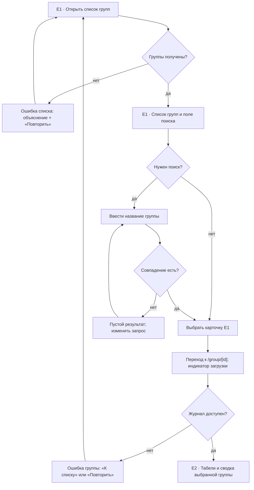
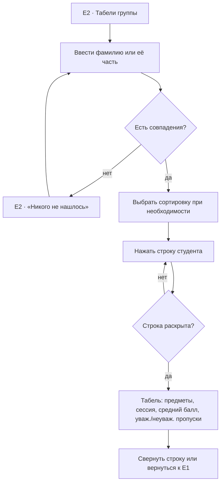
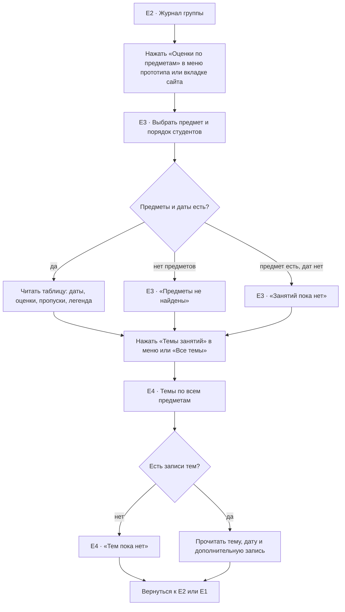
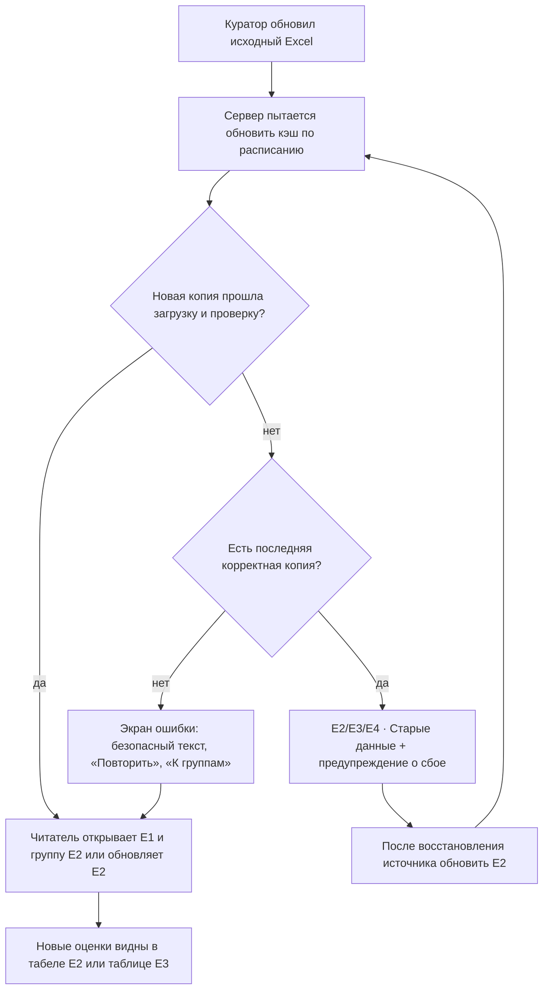
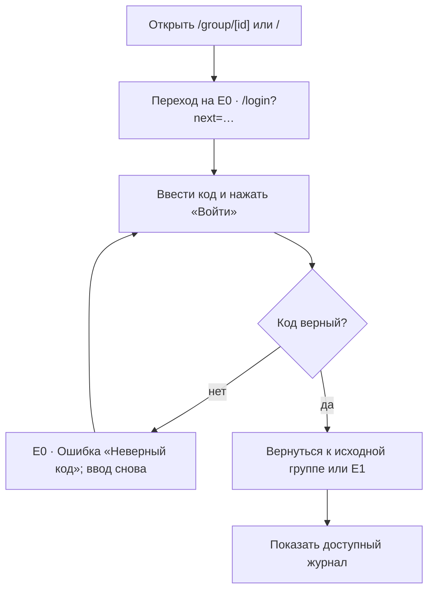

# Пользовательские сценарии

Сценарии соотнесены с пользовательскими ситуациями КТ1: студент выбирает группу, находит себя и читает оценки (US-1); куратор или преподаватель обновляет Excel (US-2); родитель с доступом читает журнал (US-3). Обозначения US-1–US-3 введены в [актуализированном ТЗ](requirements.md), потому что в КТ1 истории описаны прозой. S1–S2 относятся к MVP FR-01–FR-04, S3 — к дополнительному виду предмета и тем, S4 — к обновлению данных, S0 — к условному входу.

## S1. Найти и открыть журнал группы — MVP

**История US-1:** студент выбирает свою группу, чтобы открыть журнал. **Требование:** FR-01. **Старт:** адрес сайта `/` (при включённом коде сначала S0).

**Успех:** в E2 видны название выбранной группы, сводка, навигация разделов и список студентов. **Альтернативы:** отсутствие совпадений не уводит со страницы; ошибка источника даёт путь назад и повтор. Кнопки в блоках ошибки — целевое UX-решение, которого пока нет в коде. В прототипе КТ2 поиск виден даже при четырёх группах; текущий сайт скрывает его при числе групп меньше восьми.

## S2. Посмотреть табель обучающегося — MVP

**История US-1:** студент находит себя по части ФИО и раскрывает табель, чтобы увидеть средний балл, оценки и пропуски. **Требования:** FR-02–FR-04. **Старт:** E2 после выбора группы.

**Успех:** табель нужного студента раскрыт под его строкой. **Альтернатива:** поиск без совпадений показывает подсказку, запрос можно изменить; повторное нажатие сворачивает табель. Поиск не учитывает регистр и различие `е/ё`.

## S3. Посмотреть оценки предмета и темы — расширенный сценарий

**Расширение US-1:** читатель выбирает дисциплину, видит оценки по датам и читает темы занятий. **Требования:** FR-05 и UX-03. **Старт:** E2 выбранной группы.

**Успех:** пользователь увидел оценки выбранного предмета и темы занятий группы. **Альтернативы:** отсутствие предметов, дат или тем оформлено отдельным пустым состоянием. Из E3 можно также прочитать темы выбранного предмета прямо под таблицей. При возврате из E4 в «Журнал» ранее выбранная вкладка сохраняется только в текущем сеансе страницы; после перезагрузки откроются E2/«Табели».

## S4. Обновить Excel и получить данные на сайте — сквозной сценарий КТ1

**История US-2:** куратор или преподаватель меняет исходный Excel, и посетитель видит новую запись без ручного переноса в сайт. **Требования:** FR-07, FR-08, NFR-04. **Старт:** файл Excel у настроенного источника, вне веб-интерфейса журнала.

**Успех:** после обновления и нового открытия/перезагрузки страницы видны значения из новой проверенной копии Excel. **Альтернативы:** при временном сбое сервер сохраняет старую копию, при отсутствии копии показывает ошибку. Предупреждение о старой копии и кнопки экрана ошибки — **проектное поведение КТ2**, которого в текущем интерфейсе ещё нет; сервер сейчас только записывает ошибку обновления в лог. Открытая страница не получает данные автоматически без повторной загрузки.

## S0. Войти по коду — условный сценарий MVP

**История US-3:** родитель с выданным кодом входит и продолжает просмотр запрошенной группы. **Требование:** FR-09. **Старт:** открытие `/` или `/group/[id]`, когда `JOURNAL_ACCESS_CODE` настроен и cookie доступа отсутствует.

**Успех:** в основном сайте доступ сохраняется в cookie и открывается исходный адрес; в прототипе это демонстрируется переходом к нужному кадру. **Альтернатива:** неверный или пустой код оставляет человека на форме с текстовой ошибкой. В основном сайте пустое поле дополнительно проверяет браузер; в прототипе оба случая обрабатывает его форма. Когда код не настроен, E0 не нужен и его адрес основного сайта перенаправляет на E1.

## Что проверить в кликабельном прототипе

Минимальный сквозной путь 1: E1 → карточка группы → E2 → раскрыть табель → свернуть/вернуться в E1. Путь 2: E1 → E2 → E3 → выбрать предмет → E4 → вернуться в журнал и к списку. Кнопки, показанные в этих путях, должны иметь работающий переход или состояние; пустые и ошибочные ветки должны быть доступны для демонстрации. Если показывается вход, S0 нужен отдельной веткой прототипа.
