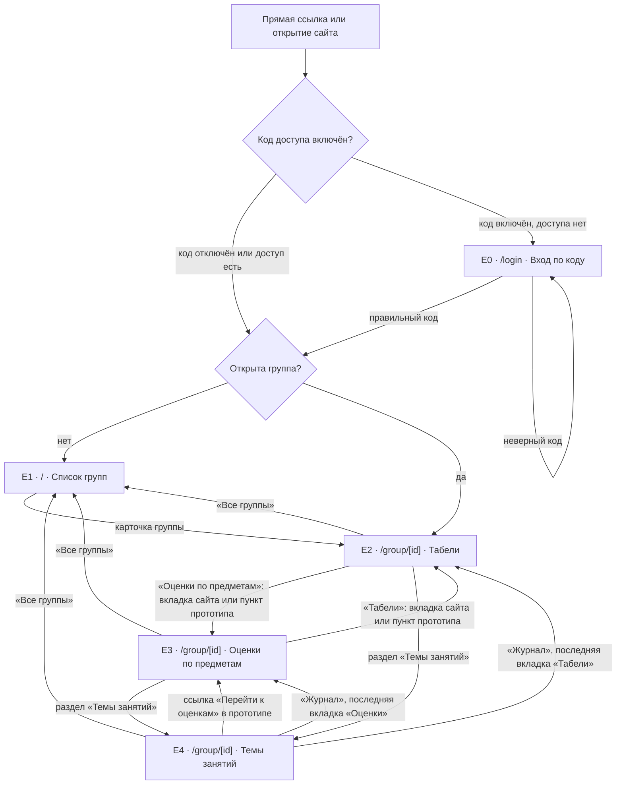

# Карта сайта и экранов

Карта фиксирует реальные маршруты и четыре разных содержательных состояния интерфейса. `E2–E4` принадлежат одной странице `/group/[id]`: на основном сайте вкладки и разделы переключаются без смены адреса. В [прототипе КТ2](prototype/index.html) они показаны как четыре демонстрационных экрана; его служебный параметр `?screen=…` выбирает макет и не является адресом страницы рабочего сайта. Внутренние `id` групп формируются сервером; пользователь попадает к ним из списка, а не вводит их вручную.

## Иерархия, назначение и доступ

| Уровень | Экран и URL | Назначение и главные действия | Доступ и переходы |
| --- | --- | --- | --- |
| 0 | **E0 Вход**, `/login?next=…` | Поле кода, кнопка «Войти», сообщение о неверном коде. | Общедоступен при включённом коде; после верного ввода открывается `next` либо E1. Если код отключён, `/login` переводит на E1. |
| 1 | **E1 Группы**, `/` | Список групп, поиск, переключатель темы, внешняя ссылка на бот. | Доступен всем при отключённом коде; при включённом — только после входа. Карточка ведёт к E2 выбранной группы. В коде поиск появляется при 8+ группах, в макете КТ2 он показан всегда. |
| 2 | **E2 Табели**, `/group/[id]`, раздел «Журнал», вкладка «Табели» | Сводка группы, поиск и сортировка обучающихся, раскрытие табеля с предметами и пропусками. | Те же правила доступа. Открывается из E1 или по прямой ссылке после входа. Переходы в E3, E4 и назад в E1. |
| 2 | **E3 Оценки по предметам**, тот же `/group/[id]`, раздел «Журнал», вкладка «Оценки по предметам» в коде | Выбор предмета, сортировка, таблица оценок и пропусков по датам, темы выбранного предмета. | Те же правила доступа. В коде вход через вкладку из E2; в прототипе — прямой пункт меню. Назад в E2, в E4 или E1. |
| 2 | **E4 Темы занятий**, тот же `/group/[id]`, раздел «Темы занятий» | Список тем и заданий по всем предметам группы. | Те же правила доступа. Вход через боковое меню или нижнюю мобильную навигацию из E2/E3; назад в журнал или E1. Прототип добавляет в карточку предмета прямую ссылку к E3. |

Системные состояния E1–E4: загрузка группы, пустой список/результат, ошибка чтения списка или журнала; для E2–E4 нужен также баннер «Показана последняя сохранённая копия» при сбое обновления по FR-08. Они входят в макеты соответствующих экранов, а не образуют отдельные страницы. Внешняя ссылка «Телеграм-бот» открывает `https://t.me/SKIBJOURNAL_BOT` и не относится к внутренней карте.

## Переходы и достижимость

1. Начальная точка — E1 или, если задан код и нет доступа, E0. E2 достижим через любую карточку группы. E3 достижим из E2 нажатием вкладки. E4 достижим из E2/E3 через меню. У всех содержательных экранов предусмотрен возврат к списку групп.
2. В текущем коде на компьютере E2/E4 переключаются в боковом меню, E2/E3 — вкладками; на телефоне E2/E4 доступны в нижней навигации, E2/E3 — вкладками. Прототип КТ2 предлагает прямые пункты «Табели», «Оценки по предметам», «Темы занятий» в боковой и нижней навигации. Это проектное изменение нужно перенести в код после утверждения.
3. При прямом открытии `/group/[id]` начальное состояние всегда E2. После обновления страницы выбранный раздел, предмет, сортировка и раскрытые табели сейчас сбрасываются: они хранятся в состоянии клиента, а не в URL. При возврате из E4 в «Журнал» сохраняется последняя вкладка E2 или E3 в текущем сеансе. Прямая ссылка на E3/E4 пока невозможна; для прототипа следует реализовать клики, но не выдавать отдельный URL за существующий.
4. Ошибка неизвестной группы или источника сейчас показывает `ErrorScreen` без кнопки возврата. Чтобы правило «нет тупиковых страниц» выполнялось буквально, в целевом макете ошибки нужны «К списку групп» и «Повторить», затем аналогичное поведение в приложении. Текст ошибки должен быть безопасным: NFR-07 запрещает раскрывать внутренние пути и секреты.
5. Прямая ссылка на E2 при включённом коде: переход в E0 с параметром `next`, ввод кода, возврат в ту же группу. При ошибке ввода E0 остаётся доступным для повторной попытки.

## Маршруты данных

`/api/groups` и `/api/journal?group=ID` — API, не отдельные пользовательские страницы. Они используются сервером и не увеличивают число экранов. Вебхук `/api/telegram` не показан в карте, потому что им пользуется бот, а не посетитель сайта.
