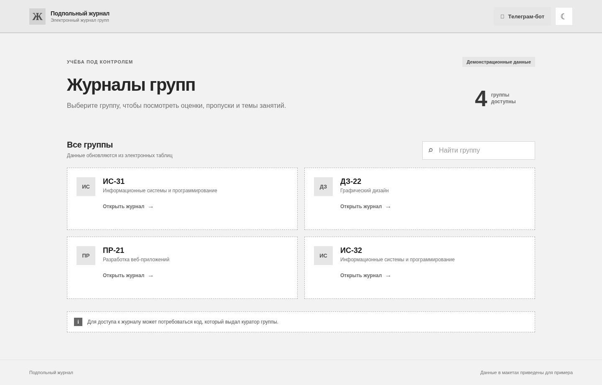
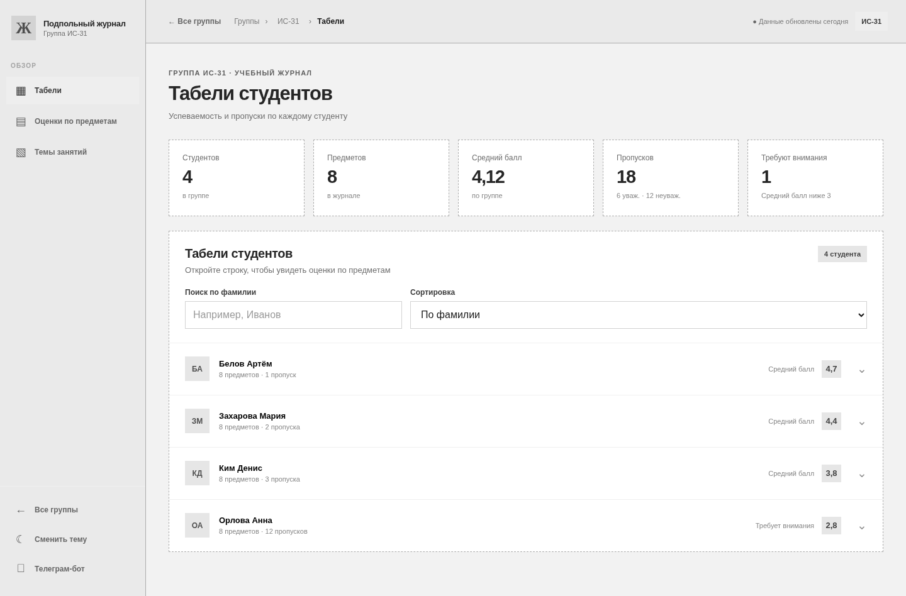
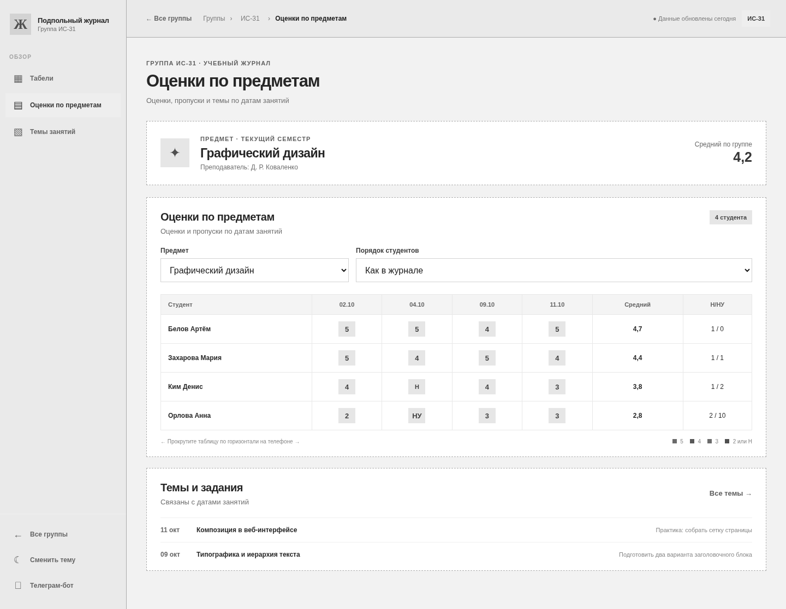
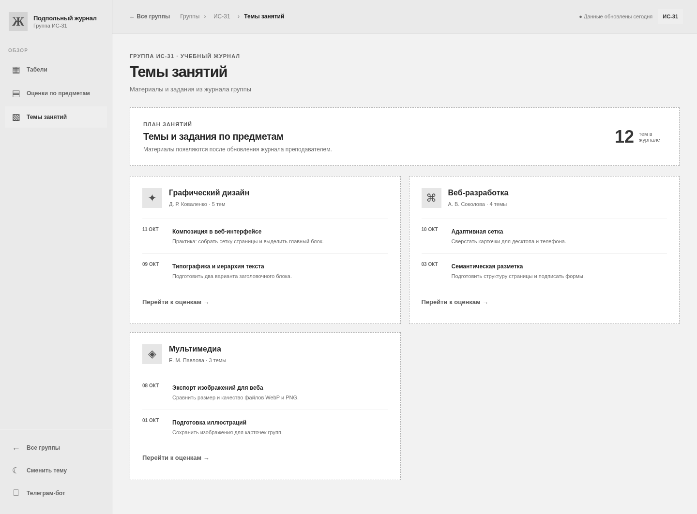

# Схематичные прототипы четырёх экранов

Ниже размещены низкодетализированные экспортированные каркасы. Они показывают положение шапки, навигации, изображений/логотипа, блоков, форм, таблиц, кнопок и текста. [Кликабельный источник](prototype/index.html) редактируется как HTML/CSS/JS; переключатель «Каркасы» в нём показывает те же экраны без декоративной отделки. Данные «ИС-31», «Белов Артём» и названия дисциплин вымышлены для демонстрации.

**Контрольные размеры:** 1440 px для компьютера, 390 px для телефона, 768 px для предмета на планшете. [Экспорт 360 px](mockups/subjects-360.png) и просмотр прототипа в Chromium закрывают отдельную проверку ширины NFR-01 для прототипа; основной сайт здесь не проверялся. Экраны E2–E4 в готовом сайте являются состояниями одного адреса /group/[id]; прототип показывает их отдельными демонстрационными кадрами. Пользователь переходит между ними кнопками.

## E1. Выбор группы — /

[Графический макет 1440 px](mockups/groups-desktop.png) · [Графический макет 390 px](mockups/groups-mobile.png)

Порядок сверху вниз: шапка с логотипом, ботом и переключателем темы → крупный вводный блок с числом доступных групп → заголовок «Все группы» и поле поиска → сетка из четырёх карточек → пояснение о возможном коде → короткий подвал. Карточка содержит условную пиктограмму, код группы, описание и действие «Открыть журнал». На телефоне карточки идут одной колонкой, поиск расположен над ними, шапка компактнее.

**Действия:** поиск фильтрует карточки; пустой результат даёт сообщение и сброс запроса; нажатие карточки открывает E2, а при включённом коде сначала E0. [Пример пустого результата на телефоне](mockups/search-empty-mobile.png).

**Проектное отличие от сайта:** в этих макетах поиск виден при четырёх группах, тогда как код показывает его при восьми и более. Подвал и крупный вводный блок тоже относятся к предложенному дизайну.

## E2. Табели и карточка студента — /group/[id]

[Графический макет 1440 px](mockups/reports-desktop.png) · [Графический макет 390 px](mockups/reports-mobile.png) · [Раскрытая карточка на компьютере](mockups/student-card-desktop.png) · [Раскрытая карточка на телефоне](mockups/student-card-mobile.png)

Порядок: боковая панель с логотипом и пунктами разделов → верхняя шапка с «Все группы», хлебными крошками и текущей группой → заголовок «Табели студентов» → пять метрик (студенты, предметы, средний балл, пропуски, требуют внимания при среднем ниже 3) → блок табелей с поиском по фамилии и сортировкой → строки обучающихся. У раскрытой строки под именем появляется таблица предметов, среднего балла, сессии и пропусков.

На телефоне боковое меню заменяется верхней кнопкой и нижней навигацией; метрики располагаются в две колонки, последняя занимает отдельную строку. Поиск и сортировка становятся полными строками. Раскрытый табель находится внутри карточки; если таблица шире её, она прокручивается внутри блока.

**Действия и состояния:** ввод имени, смена сортировки, раскрыть/свернуть строку, перейти в E1/E3/E4; без совпадений — понятное пустое состояние. Для FR-08 предусмотрен дополнительный баннер «Источник временно недоступен. Показана копия от [дата последней успешной загрузки]» под шапкой; его концепт есть в UI Kit, а код сайта пока не передаёт такой статус.

## E3. Оценки по предметам — тот же /group/[id]

[Графический макет 1440 px](mockups/subjects-desktop.png) · [Графический макет 768 px](mockups/subjects-tablet.png) · [Графический макет 390 px](mockups/subjects-mobile.png) · [Проверочный экспорт 360 px](mockups/subjects-360.png)

Порядок: общая навигация группы → заголовок раздела → шапка выбранного предмета с преподавателем и средним по группе → блок с двумя select («Предмет», «Порядок студентов») → таблица: студент по строке, даты и оценки по столбцам, затем средний балл и пропуски → подсказка о горизонтальной прокрутке и легенда оценок → темы и задания выбранного предмета, ссылка «Все темы».

На планшете боковая панель становится выдвижной, а в проектном прототипе нижняя навигация уже видна. На телефоне select идут один под другим, таблица прокручивается **внутри карточки по горизонтали**, сохраняя основной экран в ширине 390 px. Это целевое решение: действующий сайт при избытке дат уменьшает всю таблицу через zoom, поэтому требует отдельной проверки читаемости при 360 px.

**Действия и состояния:** выбрать предмет, изменить порядок студентов, открыть E4 по ссылке тем, вернуться в E2/E1; если предметов или дат нет, показать отдельное пустое состояние. Дата, оценка и вид пропуска читаются текстом, цвет лишь помогает распознаванию.

## E4. Темы занятий — тот же /group/[id]

[Графический макет 1440 px](mockups/topics-desktop.png) · [Графический макет 390 px](mockups/topics-mobile.png)

Порядок: общая шапка и навигация → заголовок «Темы занятий» → вводный блок с количеством тем → карточки предметов. В каждой карточке: пиктограмма, название дисциплины, преподаватель, число тем; далее дата, тема и дополнительное задание; внизу действие «Перейти к оценкам». На телефоне карточки выстраиваются вертикально, а навигация остаётся внизу.

**Действия и состояния:** перейти к E3 по карточке предмета, вернуться в E2 или E1; при отсутствии записей показать «Тем пока нет». Прямые ссылки из карточек тем к оценкам — **проектное дополнение прототипа**, которого нет в текущем компоненте сайта.

## Дополнительные кадры

- [Вход по коду, компьютер](mockups/login-desktop.png) и [неверный код, телефон](mockups/login-error-mobile.png): условный экран E0. Поле с подписью, кнопка входа, текстовая ошибка; при верном коде возврат к запрошенной группе.
- [Графический UI Kit](mockups/kit-desktop.png): единые кнопки, поля, цвета, метки оценок, скелетон, пустой результат, успех, ошибка, недоступность и проектируемое предупреждение FR-08. Правила в [спецификации](ui-kit.md).

Ни один из этих дополнительных кадров не заменяет четыре основные пары «компьютер + телефон». PNG служат для просмотра и сдачи, а исходный HTML/CSS/JS прототипа — для редактирования и проверки переходов.
